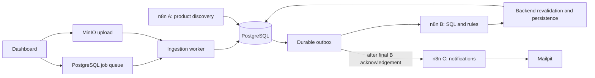

# Loan Eligibility Engine

A CSV-to-notification pipeline built with FastAPI, PostgreSQL and three n8n workflows. It validates borrower records, evaluates them against versioned loan criteria, and records decisions with supporting evidence. Results mean **POSSIBLY_ELIGIBLE**, never loan approval; incomplete criteria produce **REVIEW_REQUIRED** without email.

## Problem

Checking every borrower against every product wastes comparisons and makes decisions difficult to trace. This project separates ingestion, candidate selection, rule evaluation and notification while preserving each upload's history.

## Main features

- Signed CSV uploads, row validation and immutable per-job user snapshots.
- SQL candidate filtering followed by explicit eligibility rules and backend revalidation.
- Durable workflow dispatch, paged matching and idempotent persistence.
- An operator dashboard with job-specific results and controlled local email capture.

## Architecture



The local queue is a durable job adapter. The unverified AWS path uses S3 events and SQS with shared ingestion logic. Matching pages contain up to **1,000 candidates**; cursor and results persist atomically. See [architecture](docs/architecture.md) and [design decisions](docs/design-decisions.md).

## Tech stack

Python 3.12, FastAPI, SQLAlchemy/Alembic, PostgreSQL, n8n, MinIO, Mailpit, Docker Compose, and a plain JavaScript frontend. The AWS template targets Lambda, S3 and SQS with separately provisioned private database and n8n infrastructure.

## Quick start with Docker Compose

For a **fresh local installation on Windows**, install Python 3.12, Node 22+ and Docker Desktop with Linux containers:

```powershell
py -3.12 -m venv .venv
.\.venv\Scripts\python.exe -m pip install -r backend/requirements-dev.txt
powershell -ExecutionPolicy Bypass -File scripts/setup.ps1
$env:PYTHONPATH = 'backend;.'
.\.venv\Scripts\python.exe scripts/import_n8n.py
```

Setup creates `.env` from [.env.example](.env.example) only when absent, generates local secrets, builds services and starts Compose. The first MinIO build needs network access. Import configures credentials, publishes A/B/C and restarts n8n; wait for healthy services. **Import rotates the local n8n database reader password**, so it is a setup operation, not a routine verification command. Follow [n8n setup](n8n/README.md) for credential details.

Open the [dashboard](http://localhost:8000), [n8n](http://localhost:5678) and [Mailpit](http://localhost:8025). Enter `API_TOKEN` from `.env` into the dashboard; it remains in page memory. Environment configuration includes database/object-storage credentials, `WORKFLOW_SECRET` and a controlled `NOTIFICATION_TEST_INBOX`. Keep `.env` and `users.csv` private and Git-ignored.

For an existing installation, preserve its environment and Compose overrides. The current integration stack uses a separate Mailpit inbox on port **18025**; the fresh-install default is 8025. Routine shutdown is `docker compose down` without deleting volumes. See [troubleshooting](docs/troubleshooting.md).

## Upload a CSV and run the workflow

1. Keep the supplied `users.csv` in the project root; it is not included in Git.
2. Run **n8n A: fictional discovery** in the dashboard to load fixture products.
3. Upload the CSV and select its generated job to inspect ingestion, matching and notification counts.
4. Inspect the corresponding A/B/C executions in n8n and captured messages in Mailpit.

Each upload creates new history. Do not repeat the 10,000-user upload just to inspect an existing job. Notifications use the configured test inbox, never CSV recipients. The [script index](scripts/README.md) describes optional demonstration and replay commands.

## Workflows A, B and C

| Export | Responsibility |
|---|---|
| [A: product discovery](n8n/workflows/A_loan_product_discovery.json) | Load fictional fixtures; live sources require explicit permission review. |
| [B: user matching](n8n/workflows/B_user_loan_matching.json) | Select candidates with SQL, evaluate rules in pages, and submit results for backend validation. |
| [C: notification](n8n/workflows/C_user_notification.json) | Deliver controlled notifications after B finishes, retaining delivery state for reconciliation. |

The [workflow guide](n8n/README.md) explains import, credentials and retries. Unknown rules are not treated as satisfied. Ambiguous email sends require reconciliation; external delivery is not claimed to be exactly once.

## Matching optimization and measured results

The historical **10,000-user** run reduced **30,000 candidate comparisons to 13,302**, a **55.66% reduction in comparisons**, not runtime. Its 13,302 outcomes and 3,302 job-specific Mailpit captures are retained in the [evidence index](reports/README.md). Timing samples and query plans are explained in [optimization](docs/optimization.md).

A separate controlled local integration run on 21 October used **36 synthetic users**, produced **59 oracle-equivalent outcomes** and captured **23 emails** in isolated Mailpit. It verified the updated workflows and preserved historical data; it did not repeat the large dataset or establish a new large-scale performance result. See [integration verification](reports/integration-verification.md).

## Testing and verification

The latest bounded local regression run passed **133 tests**, with **3 deliberately deselected** (full supplied-data ingestion, supplied-CSV inspection and the SMTP preview test). See [testing commands and scope](docs/testing.md) and the [cleanup verification](reports/recruiter-cleanup.md). Tests use disposable PostgreSQL schemas; no full-dataset reprocessing is needed for this check.

Ruff, MyPy, workflow validators, Compose/static Serverless validation and frontend build are separate checks. Local HTTP/build evidence does not establish browser interaction, remote CI or cloud deployment.

## AWS and local deployment notes

Local Compose and Mailpit have recorded integration evidence. AWS configuration and local Lambda packaging exist, but the cloud stack and real SES delivery remain **unverified**. See [deployment prerequisites](docs/deployment.md).

SES preparation is offline/local only. The latest authenticated account differs from the account in the reported SCP denial; account confirmation and identity/permission checks remain unresolved. No SES message was sent. See the [isolated preparation guide](n8n/ses-test/README.md); account-specific diagnostic reports stay local.

## Known limitations

- Loan products are fictional fixtures; approved live lender crawling is not demonstrated.
- The dashboard uses an operator bearer token, not multi-tenant authentication. See [security](docs/security.md).
- Optional Gemini extraction is disabled; paid API behavior remains unverified.
- Real SES receipt, AWS deployment and recorded browser demonstration remain outstanding.
- Locally retained assignment instructions permit local deployment; public AWS deployment is a bonus. Live lender discovery and actual SES receipt remain unverified assignment requirements. Submission still needs a final review, video and approved private GitHub publication/access. Requested reviewers are `ujjwalkala-clickpe`, `HarshSrivastav-Dailype`, `ManishBiswal-clickpe` and `tushar-clickpe`.

## Demo video

**[Video link pending recording]**

Show the dashboard upload, A/B/C executions, job-filtered results, comparison reduction and an actual Mailpit capture. Add the recording link after reviewing it for secrets and personal data.
