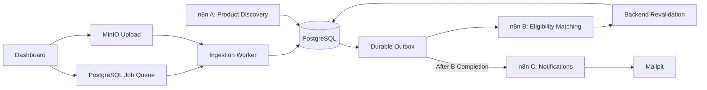

# Loan Eligibility Engine

A loan eligibility screening pipeline built with **FastAPI, PostgreSQL, n8n, and Docker** to process borrower CSV files, evaluate loan product criteria, and automate notifications.

The system uses SQL-based candidate filtering to reduce unnecessary comparisons, processes matching results in manageable batches, and maintains a traceable history of every upload.

**Key result:** Processed **10,000 borrowers** and reduced candidate comparisons from **30,000 to 13,302 — a 55.66% reduction in comparisons**.

[**Watch the Project Demo**](https://youtu.be/98zjUfsD70Q)

> **Note:** This is an eligibility screening system, not a loan approval platform. `POSSIBLY_ELIGIBLE` indicates a potential match, while incomplete criteria produce `REVIEW_REQUIRED` without triggering an email.

## Main Features

- **CSV Ingestion:** Signed uploads, input validation, and immutable borrower snapshots for each processing job.
- **Optimized Matching:** SQL candidate filtering followed by rule-based eligibility evaluation and backend revalidation.
- **Workflow Automation:** Three n8n workflows for loan product discovery, borrower matching, and notifications.
- **Scalable Processing:** Paginated matching with up to 1,000 candidates per page and durable workflow dispatch.
- **Reliable Persistence:** Idempotent processing, database-backed job history, and notification state tracking.
- **Operator Dashboard:** Upload CSV files, monitor jobs, and inspect eligibility results.
- **Email Testing:** Controlled notification delivery using Mailpit without emailing actual applicants.

## Architecture



The application separates ingestion, candidate selection, eligibility evaluation, and notification delivery.

Each upload creates an independent processing job. Matching results and pagination progress are persisted to support reliable processing and recovery.

The local deployment uses a PostgreSQL-backed job adapter. The AWS configuration provides an alternative architecture using S3 events, SQS, and Lambda, but cloud deployment has not been verified.

For implementation details, see [Architecture](docs/architecture.md) and [Design Decisions](docs/design-decisions.md).

## Tech Stack

| Component | Technology |
|---|---|
| Backend | Python 3.12, FastAPI |
| Database | PostgreSQL |
| ORM and Migrations | SQLAlchemy, Alembic |
| Workflow Automation | n8n |
| Object Storage | MinIO |
| Frontend | HTML, CSS, JavaScript |
| Email Testing | Mailpit |
| Containerization | Docker, Docker Compose |
| AWS Configuration | Lambda, S3, SQS, SES |
| Testing | Pytest, Ruff, MyPy |

## Getting Started

### Prerequisites

For a fresh local installation on Windows:

- Python 3.12
- Node.js 22+
- Docker Desktop with Linux containers
- Git

### 1. Clone the repository

```powershell
git clone https://github.com/yaswanth-reddy14/loan-eligibility-engine.git
cd loan-eligibility-engine
```

### 2. Create the Python environment

```powershell
py -3.12 -m venv .venv
.\.venv\Scripts\python.exe -m pip install -r backend/requirements-dev.txt
```

### 3. Initialize the application

```powershell
powershell -ExecutionPolicy Bypass -File scripts/setup.ps1
```

The setup script initializes the local environment, generates required secrets when appropriate, builds the services, and starts Docker Compose.

It creates `.env` from [.env.example](.env.example) only if `.env` does not already exist.

The initial MinIO build requires network access.

### 4. Configure n8n workflows

```powershell
$env:PYTHONPATH = 'backend;.'
.\.venv\Scripts\python.exe scripts/import_n8n.py
```

This imports and configures the three workflows and their local credentials.

**Important:** The import process rotates the local n8n database reader password. Run it during initial setup, not as a routine verification command.

See [n8n Setup](n8n/README.md) for configuration details.

### 5. Open the application

| Service | Local URL |
|---|---|
| Dashboard | http://localhost:8000 |
| n8n | http://localhost:5678 |
| Mailpit | http://localhost:8025 |

The existing integration environment may use a separate Mailpit inbox on port `18025`.

Enter the `API_TOKEN` from your local `.env` file into the dashboard when required.

Keep `.env`, credentials, and borrower CSV files private.

For existing installations, preserve the current environment, Docker volumes, and Compose overrides.

To stop the application without deleting its volumes:

```powershell
docker compose down
```

For additional guidance, see [Troubleshooting](docs/troubleshooting.md).

## How It Works

### Step 1 — Load Loan Products

Run Workflow A through the dashboard to load the fictional loan products and their eligibility criteria.

### Step 2 — Upload Borrower Data

Prepare a CSV using the expected schema and upload it through the dashboard.

For the supplied assignment dataset, keep `users.csv` in the project root. It is intentionally excluded from Git.

The backend validates the records and creates a separate job for the upload.

### Step 3 — Evaluate Eligibility

The matching engine first filters candidate borrower-product combinations using SQL.

Detailed eligibility rules are then applied to the remaining candidates.

Results are revalidated by the backend before persistence.

### Step 4 — Review Results

Select the corresponding job in the dashboard to inspect:

- Ingestion and processing status
- Matching outcomes
- Potentially eligible applicants
- Cases requiring further review
- Notification counts

Results are associated with their upload job to preserve processing history.

### Step 5 — Verify Notifications

Workflow C processes notification-ready results after matching completes.

Emails are routed to a configured test inbox and captured using Mailpit.

CSV recipient addresses are not used for live delivery.

See [Scripts](scripts/README.md) for optional demonstration and replay commands.

## n8n Workflows

The automation is divided into three independent workflows.

| Workflow | Responsibility |
|---|---|
| [A — Loan Product Discovery](n8n/workflows/A_loan_product_discovery.json) | Loads fictional loan products and their eligibility criteria into PostgreSQL. |
| [B — User Loan Matching](n8n/workflows/B_user_loan_matching.json) | Filters candidates using SQL, evaluates eligibility rules in pages, and submits results for backend validation. |
| [C — User Notification](n8n/workflows/C_user_notification.json) | Processes notification-ready results and records delivery state. |

Separating these responsibilities makes the system easier to maintain and allows matching and notifications to be handled independently.

Unknown or incomplete criteria are not treated as satisfied.

Notification handling includes state tracking and reconciliation for ambiguous delivery outcomes. External email delivery is not claimed to be exactly once.

See [Workflow Documentation](n8n/README.md).

## Matching Optimization

The matching engine uses SQL filtering to reduce the number of borrower-product combinations that require detailed evaluation.

### Historical 10,000-User Test

| Metric | Result |
|---|---:|
| Borrowers processed | 10,000 |
| Sample loan products | 3 |
| Baseline candidate comparisons | 30,000 |
| Comparisons after SQL filtering | 13,302 |
| Candidate comparison reduction | **55.66%** |
| Recorded matching outcomes | 13,302 |
| Job-specific Mailpit captures | 3,302 |

The optimization reduced candidate comparisons from **30,000 to 13,302**, avoiding **16,698 unnecessary comparisons**.

This is a measurement of reduced comparison count, **not a 55.66% improvement in execution time**.

See [Optimization Analysis](docs/optimization.md) and [Evidence Index](reports/README.md).

### Controlled Integration Verification

A separate local integration test on 21 October 2026 used synthetic applicant data to validate the updated workflows.

| Metric | Result |
|---|---:|
| Synthetic borrowers | 36 |
| Verified matching outcomes | 59 |
| Captured Mailpit emails | 23 |

The matching outcomes agreed with an independent reference evaluation.

The test also checked pagination, notification replay behavior, and preservation of existing historical records.

This smaller integration run does not represent a repeat of the 10,000-user performance test.

See [Integration Verification](reports/integration-verification.md).

## Testing and Verification

The latest recorded local regression run produced:

**133 tests passed, 3 deliberately deselected.**

The deselected tests covered full supplied-data ingestion, supplied-CSV inspection, and SMTP preview behavior.

Additional checks included:

- Ruff linting
- MyPy type checking
- n8n workflow validation
- Docker Compose configuration validation
- Static Serverless configuration validation
- Frontend build
- Documentation link checks
- Known-secret scanning

The tests use disposable PostgreSQL schemas where appropriate, avoiding unnecessary reprocessing of the historical dataset.

See [Testing Documentation](docs/testing.md) and [Cleanup Verification](reports/recruiter-cleanup.md).

## Deployment

### Local Deployment

The application runs locally through Docker Compose, including its backend, database, workflow automation, object storage, dashboard, and test email infrastructure.

Local workflow integration and Mailpit notification capture have been verified.

### AWS Configuration

The repository includes AWS Serverless configuration targeting Lambda, S3, and SQS.

An isolated SES test workflow and supporting configuration are also provided.

However, the AWS cloud stack has not been deployed and real SES email delivery has not been verified.

See [Deployment Documentation](docs/deployment.md) and [SES Preparation](n8n/ses-test/README.md).

## Known Limitations

- Loan product discovery currently uses fictional fixtures; live lender crawling has not been demonstrated.
- AWS cloud deployment and real SES delivery remain unverified.
- The dashboard uses an operator bearer token rather than multi-tenant authentication.
- Optional Gemini-based extraction is disabled, and live provider API behavior has not been verified.

See [Security Considerations](docs/security.md) for additional details.

## Demo Video

**[Watch the Loan Eligibility Engine Demo](https://youtu.be/98zjUfsD70Q)**

The demonstration covers the dashboard, CSV processing, eligibility matching, n8n workflows, notification capture, and measured optimization results.
