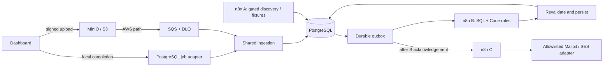

# Loan Eligibility Engine

Validate a user CSV, evaluate possible loan eligibility, and trace discovery, matching and notification through n8n. Results mean **POSSIBLY_ELIGIBLE**, never approval. Incomplete requirements produce **REVIEW_REQUIRED** and do not trigger email.

The demonstrated local dataset contains 10,000 distinct users, 13,302 outcomes and 3,302 controlled Mailpit captures. SQL reduces the candidate set from 30,000 to 13,302 (55.66%). Local timing varies; this is not a whole-pipeline speedup claim. Products are fictional fixtures. AWS deployment, actual SES receipt, permitted live crawling, browser interaction and recorded demo evidence remain outstanding.

Technical documentation:

- [Architecture](docs/architecture.md) and [Mermaid diagram source](docs/architecture.mmd)
- [Deployment](docs/deployment.md)
- [Design decisions](docs/design-decisions.md)
- [Matching optimization](docs/optimization.md)
- [Security](docs/security.md)
- [Lender source review](docs/source-review.md)
- [Troubleshooting](docs/troubleshooting.md)

See the [verification evidence index](reports/README.md) for report producers and evidence limitations.

## Architecture



The local queue is a durable job adapter, not an S3 event emulator. The cloud template connects S3 to SQS and the same ingestion logic. n8n B runs the SQL prefilter and advanced rules; the backend checks its proposed decisions before committing them. Only B's final acknowledgement queues C. [Architecture](docs/architecture.md) and [design decisions](docs/design-decisions.md) describe the boundaries.

## Run locally on Windows

Prerequisites: Python 3.12, Node 22+, and Docker Desktop with Linux containers. Keep the supplied `users.csv` in the project root; it is private and Git-ignored.

```powershell
py -3.12 -m venv .venv
.\.venv\Scripts\python.exe -m pip install -r backend/requirements-dev.txt
powershell -ExecutionPolicy Bypass -File scripts/setup.ps1
$env:PYTHONPATH = 'backend;.'
.\.venv\Scripts\python.exe scripts/import_n8n.py
```

Setup generates local secrets only when `.env` is absent, builds the app, and starts the persistent services. The first MinIO build compiles pinned upstream source and needs network access. Import publishes A/B/C and restarts n8n; wait for its health check before starting a job. The pinned n8n version warns that PostgreSQL 16 receives compatibility support only; production needs a tested supported-version upgrade.

Open [dashboard](http://localhost:8000), [n8n](http://localhost:5678), and [Mailpit](http://localhost:8025). Enter `API_TOKEN` from `.env` into the dashboard's password field; it stays in page memory. Run **n8n A: fictional discovery**, then upload `users.csv`. Select the generated job to inspect its counts. Follow [n8n setup](n8n/README.md) for credentials and [troubleshooting](docs/troubleshooting.md) for startup failures.

## Verify

```powershell
$env:PYTHONPATH = 'backend;.'
$env:RUN_MAILPIT_TEST = '1'
.\.venv\Scripts\python.exe scripts/run_checks.py
.\.venv\Scripts\python.exe scripts/demo.py --timeout 900
.\.venv\Scripts\python.exe scripts/recruiter_verify.py
.\.venv\Scripts\python.exe scripts/benchmark.py
.\.venv\Scripts\python.exe scripts/verify_workflow_replay.py
```

The suite covers lint/types, tests against isolated PostgreSQL schemas, migrations, workflow structure, static Serverless/Compose configuration and frontend build. The original 69 tests are retained. Supplied-file or opted-in service tests skip explicitly when their inputs are unavailable; remote CI is not claimed from a local run.

`demo.py` creates a new upload and verifies actual A/B/C work and job-specific Mailpit Message-IDs. Use `--job-id <id>` to observe an existing dashboard upload without uploading twice. The independent verifier compares persisted decisions with a Cartesian oracle. The benchmark retains five samples, medians and EXPLAIN ANALYZE; production revalidation adds a second SQL pass. See [optimization](docs/optimization.md), the [script index](scripts/README.md), and the [evidence index](reports/README.md).

## Data, API and safety

The ten-table schema stores users as immutable job snapshots. External IDs are unique within a job; matches use job/user/product/version keys. New uploads preserve history, while event replays are idempotent. Product evidence and evaluated criteria are retained. Unknown rules are never treated as satisfied, and no optional LLM is enabled.

All demo destinations come from `NOTIFICATION_TEST_INBOX`, never CSV addresses. Mailpit is local SMTP capture, **not AWS SES delivery**. Ambiguous sends require reconciliation rather than blind resend. See [security](docs/security.md) and [source review](docs/source-review.md).

[OpenAPI](http://localhost:8000/docs) documents the routes. Public API routes require the operator bearer token; internal routes require the shared workflow header. Useful endpoints are upload initialization/completion, job status, products, match summary, metrics, demo discovery, and `GET /api/dashboard?job_id=<id>`. Numeric summaries outside the job-filtered dashboard are global. This is a local operator UI, not multi-tenant authorization.

## Deployment and demonstration

[AWS deployment](docs/deployment.md) covers private RDS/n8n connectivity, IAM, costs, Linux packaging and SES prerequisites. The Lambda zip has a local base-container smoke test; the Serverless stack has not been deployed. No zero-cost RDS guarantee is made.

For a demonstration, follow the local setup and verification commands above. Show a dashboard CSV upload, the corresponding n8n A/B/C executions, job-filtered database results, the measured matching comparison and a received message in Mailpit. **Demo video: pending recording; no link available yet.** Capture real screenshots and video before adding a recording link.

Prepare a **private** GitHub repository only after reviewing staged files. Do not commit `.env`, `users.csv`, local volumes, caches or artifacts. Publication and invitations require approval. The requested collaborators are `ujjwalkala-clickpe`, `HarshSrivastav-Dailype`, `ManishBiswal-clickpe`, and `tushar-clickpe`.

Stop with `docker compose down`. Preserve named volumes for routine shutdown; deleting them destroys local data and n8n configuration. The documentation backup in Downloads is outside this repository and is not changed by setup or cleanup.
