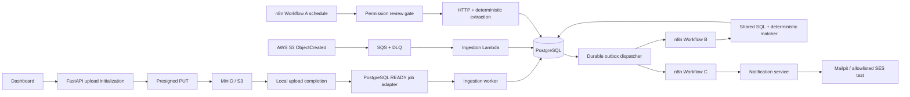

# Loan Eligibility Engine

A reproducible engineering submission for CSV ingestion, evidence-aware product matching, n8n orchestration, and safe email previews. A match means **POSSIBLY ELIGIBLE**, never approved. Unknown requirements produce **REVIEW_REQUIRED**.

Start with the [independent final recruiter audit](docs/FINAL_RECRUITER_AUDIT.md), then see the historical [delivery audit](docs/DELIVERY_AUDIT.md) and [implementation status](docs/IMPLEMENTATION_STATUS.md) for measured evidence and remaining limitations. Cloud deployment and SES are not validated by local tests.



The local queue is a transactional PostgreSQL job adapter activated by upload completion. It does not pretend to be an S3 event. Production S3→SQS invokes the same ingestion function. n8n Workflow B uses a parameterized Postgres node and reusable advanced-rule Code node. The shared backend revalidates the evaluated candidates before committing batches, so stale or unsupported workflow results cannot produce eligibility.

## Stack and prerequisites

Windows PowerShell, Docker Desktop using Linux containers, Python 3.12, and Node 22+ for the static frontend build. FastAPI, SQLAlchemy 2, Alembic, Pydantic 2, PostgreSQL 16, MinIO built from a pinned upstream release, n8n 2.43.6, Mailpit, boto3, Ruff, mypy, and pytest. Versions are compatibility pins, not a claim of a completed vulnerability audit. n8n reports PostgreSQL 16 as compatibility support only; use PostgreSQL 17+ for fresh production infrastructure. n8n is loopback-only; do not expose this development stack to the internet.

## Windows quickstart

Run from this project root. Keep the supplied `users.csv` here; it is ignored by Git.

```powershell
py install 3.12
py -3.12 -m venv .venv
.\.venv\Scripts\python -m pip install -r backend/requirements-dev.txt
powershell -ExecutionPolicy Bypass -File scripts/setup.ps1
$env:PYTHONPATH = 'backend'
.\.venv\Scripts\python scripts/import_n8n.py
```

The first build downloads and compiles MinIO, because upstream's former public container images are unavailable. Allow several minutes. The setup script creates `.env` with random local secrets and starts services with health/dependency checks. Existing `.env` is preserved.

Open dashboard <http://localhost:8000>, n8n <http://localhost:5678>, and Mailpit <http://localhost:8025>. Copy `API_TOKEN` from `.env` into the dashboard; it is retained in page memory only. Set up the local n8n owner account if prompted. Workflow credentials and import details are in [n8n/README.md](n8n/README.md).

Use the dashboard's **Run n8n A: fictional discovery** button to fetch and extract bundled fictional product HTML through n8n A, then upload `users.csv`. The API issues a five-minute presigned object PUT with a generated key and a checksum-bound job. The worker validates every row, persists batches, and commits completion with the matching outbox event. Workflow B's final acknowledgement creates a second outbox event for notifications. Mailpit captures the messages in a controlled inbox.

## Verification and benchmark

```powershell
$env:PYTHONPATH = 'backend'
.\.venv\Scripts\python scripts/inspect_csv.py
.\.venv\Scripts\python scripts/run_checks.py
.\.venv\Scripts\python scripts/demo.py --timeout 900
.\.venv\Scripts\python scripts/benchmark.py
```

`run_checks.py` configures a disposable test database from local `.env`, runs Ruff, mypy, pytest, Compose and workflow validation, and the frontend build. Integration tests create isolated random schemas; they never drop existing databases. Reports are saved under `reports/`. Supplied-data tests skip explicitly if the private CSV is unavailable in CI; CI still runs deterministic synthetic integration cases. The default benchmark selects a completed 10,000-user upload and uses products actually loaded in PostgreSQL. It asserts pair/status equality, records wall times, and captures EXPLAIN ANALYZE. Read [optimization](docs/optimization.md) before interpreting results.

## Workflows and data

- **A:** daily permission-gated HTTP discovery and audit; separate manual fictional fixture branch. Three official source candidates are configured. None is approved for automated crawling yet. No real lender criteria are invented.
- **B:** authenticated webhook → job validation/metadata → Postgres SQL prefilter ? advanced Code evaluation ? validated bulk persistence service → measured metric checks -> final B acknowledgement and C outbox. Relevant users are restricted by job. No Cartesian Python loop is used in production.
- **C:** authenticated webhook → grouped preliminary matches → HTML/text rendering → allowlisted preview delivery. B completion is checked in the database. The dispatcher repeats bounded delivery batches until the audit completes.

Fixtures use `example.org` and fictional lender names, with criterion evidence embedded in their HTML. Live products remain UNVERIFIED after extraction until a human source review establishes validity. No optional LLM integration is enabled; ambiguity requires review. `EMAIL_DELIVERY_MODE` permits only `preview` or allowlisted `test`. Original CSV addresses are never destinations.

The schema includes all ten requested tables. Users are unique by job/external ID. Matches are unique by job/user/product/matching version. Repeated identical uploads create independent audited snapshots; repeated events for the same key/job are idempotent. Products retain latest source evidence; matches snapshot evaluated criteria. Historical product revision storage is a future extension.

## API

Interactive OpenAPI docs: <http://localhost:8000/docs>. API routes require `Authorization: Bearer <API_TOKEN>`; internal routes require `X-Workflow-Secret`.

| Route | Purpose |
|---|---|
| `GET /health` | PostgreSQL connectivity |
| `POST /api/uploads` | Filename, size, SHA-256 → generated job/key and signed PUT |
| `POST /api/uploads/{id}/complete` | Verify object size/version and enqueue local ingestion |
| `GET /api/jobs/{id}` | Counts, state, safe error summary |
| `GET /api/dashboard` | Products, match/notification/outbox counts, metrics/history |
| `POST /internal/matching/{id}` | Idempotent shared matcher |
| `POST /internal/notifications/{id}` | Bounded allowlisted delivery batch |

## Deployment, security, and submission

[AWS deployment](docs/deployment.md) explains packaging, private RDS/VPC connectivity, SES and cost considerations. `serverless.yml` is a deployment template, **UNVERIFIED in AWS**. No resources are deployed automatically. RDS, NAT, SES, Lambda and storage can incur charges; zero-cost RDS cannot be guaranteed. [Security](docs/security.md) records local/cloud boundaries and limitations.

Use [demo script](docs/demo-script.md) for a nine-minute walkthrough and [troubleshooting](docs/troubleshooting.md) for common failures. Screenshot/video placeholders remain in the demo document until actual evidence exists.

Prepare a **private** repository manually after reviewing `.gitignore` and `git status --short`. Never add `.env`, `users.csv`, volumes, or credentials. Do not use `git add -f` on ignored files. In GitHub repository Settings → Collaborators, invite `ujjwalkala-clickpe`, `HarshSrivastav-Dailype`, `ManishBiswal-clickpe`, and `tushar-clickpe` after you approve sharing. No publication or invitations are performed here.

Stop without deleting data:

```powershell
docker compose down
```

Deleting named volumes permanently destroys local personal data and n8n configuration. Only if you deliberately want a reset: `docker compose down --volumes`. Do not run that for routine shutdown.

## Independent recruitment review

See [final recruiter audit](docs/FINAL_RECRUITER_AUDIT.md), [reproducible demo checklist](docs/DEMO_CHECKLIST.md), and [eight-minute spoken script](docs/demo-script.md). These supersede historical test counts and runtime claims in DELIVERY_AUDIT. Local Mailpit capture is separate from AWS SES delivery; live source discovery, AWS deployment and browser interaction require the evidence described there.
